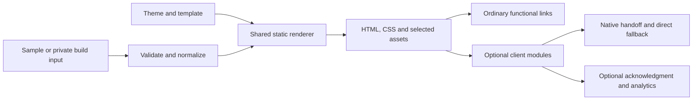

# Static Profile Platform

A lightweight, self-hosted links page with native, best-effort external-browser opening. One public repository can power a neutral portfolio demo and separately configured production sites on Cloudflare Pages Free.

The landing page renders as ordinary HTML. Its buttons keep their real HTTPS destinations when scripts, analytics, or a browser handoff fail. Experimental mobile strategies enhance supported Instagram visits; normal browsers keep normal navigation.

## Try it

Open [example.html](example.html) for the standalone neutral design, or build the full application with Node.js 22 or newer:

```sh
npm run dev
```

Visit **http://localhost:4173**. No package installation is needed to build or serve. Rebuild and refresh after editing settings. `npm run build` generates `dist/index.html`, which also opens directly from disk for the basic page; use HTTP/HTTPS to test JavaScript modules.

To pick up deployment later, open **Publish with Cloudflare** beneath the neutral demo's footer. The guide includes the exact Pages settings, a deployment checklist, and troubleshooting. It works offline in `example.html` (dashboard links require internet) and appears in sample builds, including `npm run build:example`. Configured pages omit it.

The standalone example shares the production renderer and embeds its stylesheet. Refresh it explicitly with `npm run example:refresh`; normal builds leave it untouched. [Browser screenshots](docs/testing.md#browser-screenshots) can be captured from the neutral renderer; screenshots and a hosted demo URL have not yet been produced in this checkout. No live deployment is claimed.

## Features

- Responsive profile, initials or portrait, prominent primary CTA, ordered secondary links, SEO metadata, and real 404 page.
- Content and complete page styling in JSON, with per-deployment theme overrides.
- Native iOS scheme and Android intent strategies, manual Open in Browser, direct fallbacks, and loop guards.
- Optional experimental automatic iOS page handoff, off by default; Android defers to a tap.
- Optional 18+ acknowledgment, Cloudflare visit/performance analytics, and GA4 interaction events.
- Safe config serialization, security headers, selective image copying, and public-source checks.
- Unit/integration tests, a development-only Playwright suite, and neutral-input CI.

There are two opening modes: **`direct`** and **`native`**. A third-party service URL can simply be a normal destination. There is no dedicated Bouncy integration or required service account. Native handoff is experimental and still needs real-device verification; see the [compatibility matrix](docs/browser-opening.md).

## Configure a site

The JavaScript builder chooses `SITE_CONFIG_JSON` when set, otherwise `config/site.json` if present, otherwise `config/site.example.json`. A malformed or unreadable real config fails instead of silently publishing the sample.

```sh
cp -n config/site.example.json config/site.json
# Edit config/site.json, then:
npm run dev
```

**Keep the real file at `config/site.json`, beside the sample. It is Git-ignored.** `dist/`, `dist-private/`, and `.private/` also stay out of Git. Keep the committed sample and public screenshots neutral. Source privacy does not hide the public deployed page's identity, links, or browser-visible settings.

The complete [sample config](config/site.example.json) and [editor schema](config/site.schema.json) document the format. For example, merge this feature block into a complete site config:

```json
{
  "browserOpening": {
    "mode": "native",
    "autoOpen": false,
    "showManual": true,
    "iosStrategy": "instagram",
    "androidPackage": "com.android.chrome",
    "fallbackDelayMs": 1800
  },
  "ageAcknowledgment": { "enabled": false, "remember": "session" }
}
```

Old configs without feature blocks retain direct navigation. Each link can set `openingMode` to `inherit`, `direct`, or `native` and a stable, non-sensitive `id`. Full details: [content and styling](docs/configuration.md), [browser opening](docs/browser-opening.md), and [analytics](docs/analytics.md).

## Architecture



`scripts/render.mjs` owns HTML rendering. `src/client/browser-opening.js` owns pure strategy/URL decisions; `handoff-controller.js` owns attempts, timers, and lifecycle. `app.js` connects them to the DOM. Analytics reports attempts and observations, never assumed external-browser success. Read the [architecture decisions](docs/architecture.md) and [implementation status](docs/implementation-status.md).

## Cloudflare Pages

Use separate Pages projects connected to this same public repository:

| Deployment | Build command | Output | Input |
| --- | --- | --- | --- |
| Public demo | `npm run build:example` | `dist` | Neutral sample only |
| Automatic selection | `npm run build` | `dist` | Optional `SITE_CONFIG_JSON`; sample if absent in Git checkout |
| Customized preview | `npm run build:private` | `dist-private` | Production-scoped `SITE_CONFIG_JSON` |
| Configured live site | `npm run build:private:production` | `dist-private` | Same input with real domain and placeholders disabled |

Choose framework None and Node 22 or newer. Add the custom domain through Pages, supply the real config in the project's encrypted build settings, and keep production input out of untrusted preview builds. Hosting and basic analytics can use the free tier; domain registration remains separate.

Follow [Cloudflare deployment](docs/cloudflare.md) for domains, HTTPS, multiple projects, and rollback. [Security](docs/security.md) covers WAF, Managed Challenge, optional stronger verification, and in-app browser trade-offs. Security controls never change the page's destinations for reviewers.

## Verify and contribute

```sh
npm test
npm run build:example
npm run check:public
```

For browser integration tests only:

```sh
npm ci
npx playwright install chromium webkit
npm run test:browser
npm run screenshots
```

The [testing guide](docs/testing.md) separates automated evidence from real-device checks. Browser installation, screenshots, and hosted checks are still unverified in this restricted environment. See [CONTRIBUTING.md](CONTRIBUTING.md) and the [MIT license](LICENSE).

`SPEC.md` is being edited separately. Current implementation follows the user's explicit two-mode requirement; its conflicting provider-specific section needs reconciliation by the spec owner before release.
