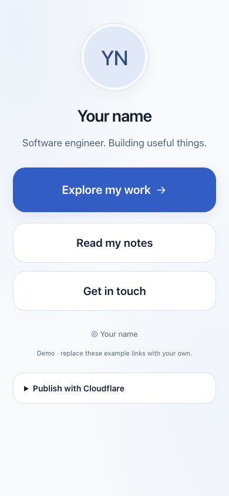
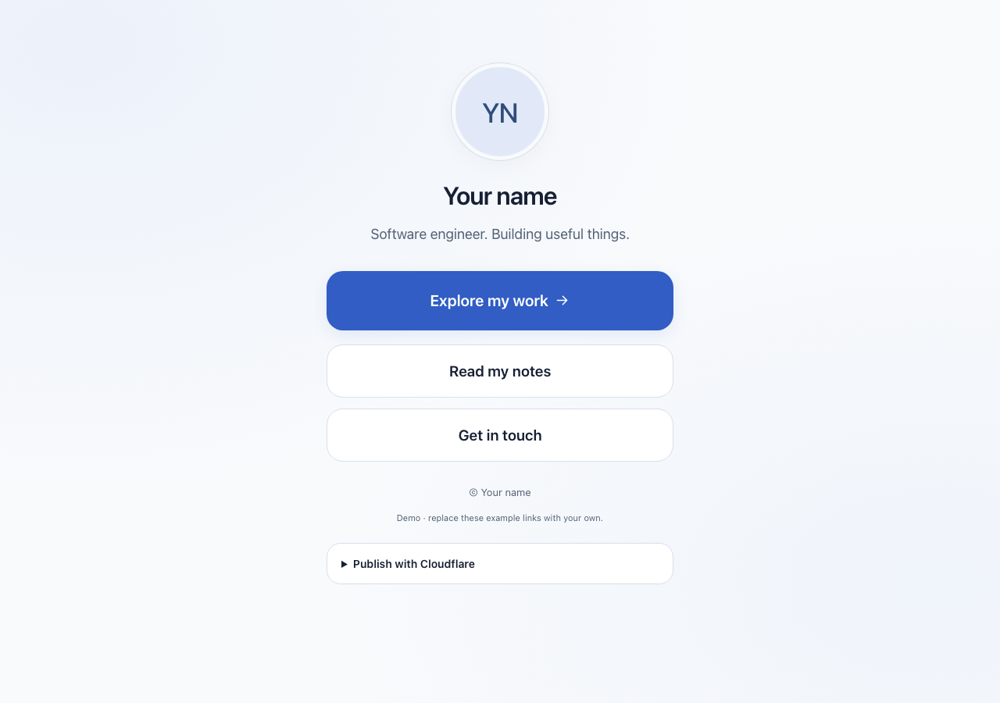
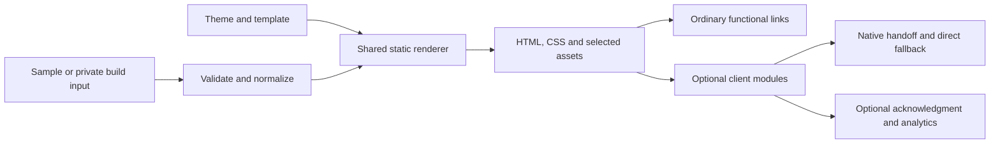

# Static Profile Platform

A lightweight, self-hosted links page with native, best-effort external-browser opening. One public repository can power a neutral portfolio demo and separately configured production sites on Cloudflare Workers Static Assets.

The landing page renders as ordinary HTML. Its buttons keep their actual destinations when scripts, analytics, or a browser handoff fail. Experimental mobile strategies enhance supported Instagram visits; normal browsers keep normal navigation.

## Try it

Open the [hosted site](https://cloudflare-link-protection.skdornel.workers.dev/). After deploying the current build, `/` is the platform landing page and `/example/` is the neutral links demo.

Open [example.html](example.html) for the standalone neutral design, or build the full application with Node.js 22 or newer:

```sh
npm run dev
```

Visit **http://localhost:4173** for the landing page, or **http://localhost:4173/example/** for the neutral profile demo. No package installation is needed to build or serve. Rebuild and refresh after editing settings. Use the HTTP preview server for generated pages and their assets; the standalone `example.html` still works directly from disk. An existing private root-profile config keeps its original root behavior.

The example keeps its visitor-facing copy generic and its footer minimal. Deployment settings, checklists, and troubleshooting are in the [Cloudflare guide](docs/cloudflare.md).

All three example buttons open a local **More soon** page with a link back. The standalone `example.html` shares the production renderer and embeds its stylesheet; keep its generated `more-soon.html` companion beside it for offline navigation. Refresh both with `npm run example:refresh`; normal builds leave them untouched. The browser captures below use the served neutral build. The [Cloudflare guide](docs/cloudflare.md#public-demo-project) explains how to deploy your own Worker.

## Screenshots

These captures predate the generic bio and the removal of the demo notice and publishing panel.

[Mobile capture](docs/images/demo-mobile.png) · [Desktop capture](docs/images/demo-desktop.png)





## Features

- Responsive profile, initials or portrait, prominent primary CTA, ordered secondary links, SEO metadata, and real 404 page.
- Content and complete page styling in JSON, with per-deployment theme overrides.
- A configurable platform landing at `/`, the neutral demo at `/example/`, and an optional creator path such as `/sample-creator`, on the same Worker.
- Native iOS scheme and Android intent strategies, manual Open in Browser, direct fallbacks, and loop guards.
- Optional experimental automatic iOS page handoff, off by default; Android defers to a tap.
- Optional 18+ acknowledgment, Cloudflare visit/performance analytics, and GA4 interaction events.
- Safe config serialization, security headers, selective image copying, and public-source checks.
- Unit/integration tests, a development-only Playwright suite, and neutral-input CI.

There are two opening modes: **`direct`** and **`native`**. A third-party service URL can simply be a normal destination. There is no dedicated Bouncy integration or required service account. Native handoff is experimental and still needs real-device verification; see the [compatibility matrix](docs/browser-opening.md).

## Configure a site

The JavaScript builder chooses `SITE_CONFIG_JSON` when set, otherwise `config/site.json` if present, otherwise `config/site.example.json`. A malformed or unreadable real config fails instead of silently publishing the sample.

```sh
cp -n config/site.example.json config/site.json
# Edit config/site.json, then:
npm run dev
```

**Keep the real file at `config/site.json`, beside the sample. It is Git-ignored.** `dist/`, `dist-private/`, and `.private/` also stay out of Git. Keep the committed sample and public screenshots neutral. Source privacy does not hide the public deployed page's identity, links, or browser-visible settings.

To keep the platform landing at `/` and put your profile at `https://example.com/sample-creator`, set `"siteUrl": "https://example.com"` and `"profilePath": "/sample-creator"` in your private config. Rebuild, then preview at **http://localhost:4173/sample-creator**. The demo stays at `/example/`. Existing configs default to a root profile. See [profile paths](docs/configuration.md#profile-paths).

The homepage starts with a short introduction and a working demo button. Change its public defaults in `config/landing.example.json` and its styling in `config/landing.theme.json`, or supply private `landing` overrides inside `config/site.json`. This keeps the homepage easy to reshape later. See [landing configuration](docs/configuration.md#platform-landing-page).

The complete [sample config](config/site.example.json) and [editor schema](config/site.schema.json) document the format. For example, merge this feature block into a complete site config:

```json
{
  "browserOpening": {
    "mode": "native",
    "autoOpen": false,
    "showManual": true,
    "iosStrategy": "instagram",
    "androidPackage": "com.android.chrome",
    "fallbackDelayMs": 1800
  },
  "ageAcknowledgment": { "enabled": false, "remember": "session" }
}
```

Old configs without feature blocks retain direct navigation. Each link can set `openingMode` to `inherit`, `direct`, or `native` and a stable, non-sensitive `id`. Full details: [content and styling](docs/configuration.md), [browser opening](docs/browser-opening.md), and [analytics](docs/analytics.md).

## Architecture



`scripts/render.mjs` owns HTML rendering. `src/client/browser-opening.js` owns pure strategy/URL decisions; `handoff-controller.js` owns attempts, timers, and lifecycle. `app.js` connects them to the DOM. Analytics reports attempts and observations, never assumed external-browser success. Read the [architecture decisions](docs/architecture.md) and [implementation status](docs/implementation-status.md).

## Cloudflare Workers

Keep the Worker connected to this repository. Set **build** to `npm run build`, **deploy** to `npx wrangler deploy`, and **root** to `/`. Leave build variables and secrets empty and keep dependency installation enabled. With no private config in the Git checkout, the build uses the neutral sample. No runtime variables or bindings are needed.

`wrangler.jsonc` serves `dist/` with security headers and real 404 responses. Its name matches `cloudflare-link-protection`. Review the deployment locally with `npm ci` followed by `npm run check:workers`; this does not publish anything.

Use separate Workers for independently deployed sites, or publish the landing, demo, and configured profile on the same Worker. Build with `npm run build:private:production`, supply `SITE_CONFIG_JSON` as a build secret, and deploy with `npx wrangler deploy --assets ./dist-private --name your-site-worker`. Use `build:private` while reviewing placeholders. Disable non-production branch builds on Workers that receive private inputs.

Follow [Cloudflare deployment](docs/cloudflare.md) for setup, domains, HTTPS, independent sites, and rollback. [Security](docs/security.md) covers WAF and Managed Challenge. Existing Pages projects can still serve the generated output, but [Cloudflare recommends Workers for new projects](https://developers.cloudflare.com/pages/).

## Verify and contribute

```sh
npm test
npm run build:example
npm run check:public
```

For browser integration tests only:

```sh
npm ci
npx playwright install chromium webkit
npm run test:browser
npm run screenshots
npm run check:performance
```

The [testing guide](docs/testing.md) separates automated evidence from real-device checks. Chromium/WebKit tests, neutral screenshots, local performance measurements, and initial live-demo checks are recorded in the [status guide](docs/implementation-status.md). Physical Instagram handoff and custom-domain checks remain pending. See [CONTRIBUTING.md](CONTRIBUTING.md) and the [MIT license](LICENSE).

Dedicated Bouncy integration is deferred. The [specification](SPEC.md) and [implementation status](docs/implementation-status.md) track the current direct/native scope and remaining release checks.
