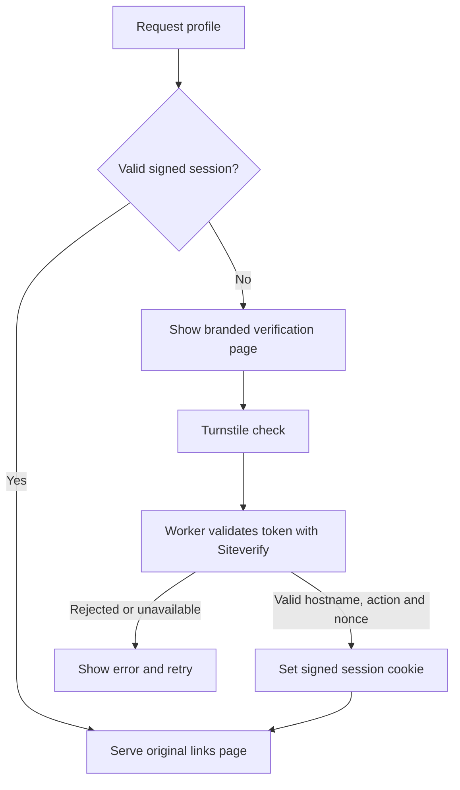

# Branded Turnstile verification

This optional gate shows a page using the profile's name, avatar, colors, and configurable text before serving its links. Cloudflare's real Turnstile widget performs the browser check. A Worker validates the token and issues an expiring signed session cookie. The gate is disabled by default and is separate from native browser opening, age acknowledgment, analytics, and WAF challenge pages.

No database, paid verification service, or extra repository is needed. The widget retains Cloudflare branding; its theme and size use supported widget options. This implementation uses a flexible-width Managed widget, switching to the supported compact layout when its card has less than 300 px of available width. [Turnstile plans](https://developers.cloudflare.com/turnstile/plans/) and [widget options](https://developers.cloudflare.com/turnstile/get-started/client-side-rendering/widget-configurations/).

## Activation on an existing Worker

1. Publish the updated application code with verification still disabled. Keep build command **`npm run build`** and deploy command **`npx wrangler deploy`**. The committed Wrangler config now runs `src/worker/index.js` before assets and provides its `ASSETS` binding automatically.
2. In Cloudflare, open **Turnstile → Add widget**. Give it a descriptive name, allow your actual hostname (hostname only, without `https://` or a profile path), and select **Managed**. Leave **Pre-clearance** off; this implementation uses its own application session. Save the site key and secret key. [Widget setup](https://developers.cloudflare.com/turnstile/get-started/widget-management/dashboard/).
3. Open **Workers & Pages → your Worker → Settings → Variables and Secrets**. Add the following as type **Secret**, then deploy the settings. These are **runtime settings**, unlike the existing `SITE_CONFIG_JSON` build secret. Store the site key as a Secret too so it is managed consistently alongside the other runtime values; it is still intentionally public in the verification HTML.

   | Runtime setting | Value |
   | --- | --- |
   | `TURNSTILE_SITE_KEY` | The widget's public site key |
   | `TURNSTILE_SECRET_KEY` | The widget's secret key |
   | `VERIFICATION_SESSION_SECRET` | An independent cryptographically random signing secret, at least 32 characters |

   Generate the signing secret in your own terminal, then paste it directly into Cloudflare:

   ```sh
   node -e 'console.log(require("node:crypto").randomBytes(32).toString("hex"))'
   ```

   Keep both secret keys out of Git, `site.json`, build variables, screenshots, and support messages. Do not reuse the Turnstile secret as the signing secret. [Worker secrets](https://developers.cloudflare.com/workers/configuration/secrets/).

4. Merge the following into the complete ignored `config/site.json`. Keep `siteUrl` set to the exact HTTPS origin used by visitors:

   ```json
   {
     "verification": {
       "enabled": true,
       "sessionMinutes": 60,
       "widgetTheme": "auto",
       "copy": {
         "heading": "A quick check before continuing",
         "description": "Please complete the security check to open this page."
       },
       "styles": {}
     }
   }
   ```

5. Replace the **build secret** `SITE_CONFIG_JSON` with the complete updated local JSON and rebuild/deploy the current GitHub commit. A configured build logs `Branded verification enabled`. Neither the full config nor runtime secrets are printed.
6. Disable the earlier broad **Profile verification / Managed Challenge** rule for this profile once the new deployment and keys are ready. Otherwise Cloudflare's standard interstitial may appear before the branded page. Ensure the gate's document, `/_verification/client.js`, `/_verification/styles.css`, and `POST /_verification/verify` can load. Keep normal managed rules and DDoS protection; resolve specific false positives rather than bypassing all WAF protections. Turnstile's application cookie does not bypass WAF or Bot Fight Mode.
7. Test in a fresh browser context and from Instagram on a real phone. See the checklist below. Until these checks are complete, treat activation as unverified.

Nothing is activated merely by installing the code. Missing runtime keys with `verification.enabled: true` produce a branded **503 unavailable** response, not the links page. Official always-pass/fail Turnstile test keys are rejected by the deployable Worker.

## Appearance and copy

The page inherits the existing profile theme and portrait/initials. Base verification layout lives in `config/verification.theme.json`; the `verification.styles` override uses the same validated `variables`, `rules`, `media`, and `keyframes` structure as the main theme and is applied last. This allows private colors, typography, spacing, backgrounds, and responsive changes without altering application code. Overrides only affect the verification page.

For example:

```json
{
  "verification": {
    "enabled": true,
    "sessionMinutes": 60,
    "widgetTheme": "light",
    "copy": {
      "heading": "Welcome to my space",
      "description": "One quick check, then you're through.",
      "footer": "Thank you for stopping by."
    },
    "styles": {
      "variables": { "accent": "#315dc4" },
      "rules": { ".verification-card": { "border-radius": "28px" } }
    }
  }
}
```

`sessionMinutes` accepts integers from 5 to 1440. `widgetTheme` accepts `auto`, `light`, or `dark`. Optional `copy` fields are `heading`, `description`, `footer`, `loading`, `verifying`, `error`, `expired`, `unavailable`, `noScript`, and `retry`; each must be nonempty and at most 500 characters. Unknown verification fields, including credentials, are rejected. Defaults live in `scripts/verification-config.mjs`, and editor support is in `config/site.schema.json`.

The gate intentionally has no outbound CTA links or analytics scripts. After verification, the original links page and its configured features work normally. Displayed branding and imagery remain public, and verified visitors can inspect the page and destinations.

With `browserOpening.mode: native` and `showManual: true`, recognized Instagram/Facebook visits also get **Open in Browser** on this gate, using the existing configurable labels. It opens the original profile page, never the verification POST endpoint. `autoOpen: true` permits a one-time experimental iOS attempt on the initial gate; set `showManual: false` to omit the manual button and browser assistance entirely. Android needs a tap; error pages and profiles requiring all-link age acknowledgment defer automatic opening. Primary-only age acknowledgment leaves same-page handoff available and prompts later on the primary CTA. The new browser may need to verify again because cookies are not transferred. A separate Cloudflare edge challenge must finish before any application code can run. See [browser opening and security ordering](browser-opening.md#verification-and-security-ordering).

## Enforcement and session behavior



- Every protected document request runs through the Worker before static serving, including directory/index aliases. Unknown paths in the profile subtree do not reveal profile HTML. Ambiguous encoded paths are rejected.
- The allowed return location must stay on the configured profile and origin. Queries and fragments survive verification. It cannot redirect to an arbitrary external destination.
- The same-origin POST is bounded to 16 KiB. Siteverify has an 8-second timeout, and the Worker checks `success`, `hostname`, `action`, and `cdata` against a signed five-minute challenge cookie. Tokens are single-use as enforced by Cloudflare. [Server validation](https://developers.cloudflare.com/turnstile/get-started/server-side-validation/).
- The session uses a host-only `Secure`, `HttpOnly`, `SameSite=Lax` cookie signed with HMAC-SHA-256. It is bound to the origin and profile path and expires after the configured time. Reopening the page in the same browser can reuse it. A different browser/app cookie store may require a new check. Cloudflare's **Challenge Passage** setting does not control this application cookie.
- Verification and protected HTML responses use `private, no-store`; the Worker adds security headers itself. Only the gate permits Turnstile's script/frame/connect origins and same-origin form submission. Cloudflare's `_headers` file alone does not cover Worker-generated responses. [Headers](https://developers.cloudflare.com/workers/static-assets/headers/) and [Turnstile CSP](https://developers.cloudflare.com/turnstile/reference/content-security-policy/).
- The gate uses `Referrer-Policy: same-origin`: its form retains the `Origin` header required by the Worker, while external widget requests receive no referrer. Do not override this with `no-referrer` in a Cloudflare response-header rule; browsers then send `Origin: null` on navigation POSTs and verification fails with “Request not allowed.” The Worker still rejects missing, null, and foreign origins. [Fetch origin-header rules](https://fetch.spec.whatwg.org/#append-a-request-origin-header).
- The generated `/_verification/manifest.json` contains only required UI/routing/header data, not the original config or any credentials. The Worker reads it through `ASSETS` and denies direct visitor access to it and other internal verification files. Public gate JS/CSS and explicitly enumerated profile assets remain available.
- The configured HTTPS origin is required for the protected profile. An alternate `workers.dev`/preview hostname returns 421 for that profile; the neutral homepage/demo can remain available on those aliases. Domain WAF settings still do not cover those alternate hostnames.
- The Worker fails closed if metadata or required credentials are missing. It never serves alternate content based on whether the visitor is a crawler, reviewer, or person. A challenge can prevent legitimate visitors or review systems from reaching the page; test the intended sharing platforms.

This is bot-friction/verification, not private membership or identity authentication. A visitor who completes the check can access and share the rendered information.

## Costs and hosting

Turnstile's Free plan supports unlimited verification requests. Worker invocations have separate limits: Workers Free currently allows 100,000 requests per day per account and 10 ms of CPU time per invocation. The shipped Worker runs before every asset request, including when verification is disabled, so this deployment no longer has the unlimited-request characteristics of an assets-only Worker. Review account usage as traffic grows. No paid plan is required to start, and exceeding a free quota does not mean unlimited free availability. [Turnstile plans](https://developers.cloudflare.com/turnstile/plans/) and [Workers limits](https://developers.cloudflare.com/workers/platform/limits/).

Deploy this feature using **Workers**, including the Worker script and assets together. Uploading only `dist/` to an ordinary static host would expose its HTML without enforcement. Pages/static-only deployments are supported only with verification disabled; a gated Cloudflare Pages build is rejected. The lightweight `npm run dev` / `preview` server also refuses gated output instead of pretending to enforce verification.

## Local verification and live checklist

Run the dependency-free Worker/client tests:

```sh
node --test tests/verification.test.mjs tests/verification-client.test.mjs
```

The browser suite adds Chromium and WebKit tests using the actual gate and Worker with a synthetic provider restricted to a test harness. These tests check cookies, real form navigation, query/fragment preservation, disabled JavaScript, blocked scripts, and mobile layout. They never visit a production challenge or use production credentials:

```sh
npm ci
npx playwright install chromium webkit
npm run test:browser
```

Cloudflare publishes [dummy test keys](https://developers.cloudflare.com/turnstile/troubleshooting/testing/) for isolated widget experiments. Use them only in a standalone local widget fixture; the deployable Worker rejects them, and its strict hostname/action/nonce validation must not be weakened to accommodate dummy responses. Automated tests inject a fake Siteverify implementation into the Worker factory; no environment flag enables that behavior in the deployed entry.

For a real end-to-end check, use a separate HTTPS staging Worker with synthetic profile data, its own runtime secrets, and a Managed widget restricted to its staging hostname. Set that hostname as the staging config's `siteUrl`. Do not put real production inputs into untrusted preview builds.

- Fresh browser: branded page appears, widget completes, original path/query/fragment and all buttons work.
- Refresh: session is reused; a new private context requires verification again. Turnstile may complete automatically without a checkbox.
- Direct `/sample-creator/index.html` requires verification too; `/_verification/manifest.json` returns 404.
- Missing key, blocked widget script, disabled cookies/JavaScript, network failure, expiry, and invalid token: no protected HTML; clear explanation/retry where possible.
- Mobile Instagram on iOS and Android: no loop, understandable retry, accessible controls, external-browser handoff works after verification. A second browser can require its own session.
- Check keyboard focus, 320 px layout, large text, reduced motion, forced colors, and the configured portrait/theme.
- Review browser console CSP errors, Worker errors/quotas, and Turnstile analytics. WAF Security Events cover WAF actions; application token rejection is not a WAF event.

## Rollback

Set `verification.enabled` to `false` in the ignored config and complete build secret, then rebuild/deploy. Restore an earlier WAF profile rule only if that is the desired replacement gate. Rotating `VERIFICATION_SESSION_SECRET` invalidates existing application sessions; changing only the Turnstile secret does not revoke existing signed sessions. Disable the gate through configuration rather than deleting the Worker script while leaving a gated build's assets publicly served.
